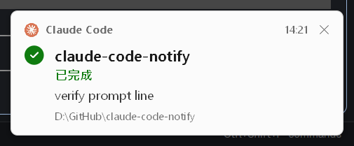

# Claude Code Notify

Windows toast notifications for Claude Code. When Claude finishes a reply or needs your input, a small card pops up above the taskbar. Click it to jump back to the window and Windows Terminal tab you were typing in.

[中文說明](README_CN.md)




This is a fork of [chuilishi/claude-code-notify](https://github.com/chuilishi/claude-code-notify). Version 1.2.0 redesigns the card, fixes argument quoting and toast stacking bugs, and trims the Rust code.

## Install

```bash
claude plugin marketplace add kglobe/claude-code-notify
claude plugin install claude-code-notify@claude-code-notify
```

Restart Claude Code. The plugin registers its hooks on its own; you don't edit `settings.json`.

To remove it:

```bash
claude plugin uninstall claude-code-notify
```

### WSL: `Permission denied`

If you installed the plugin inside WSL and the hooks fail with `Permission denied`, mark the bundled exe as executable:

```bash
chmod +x ~/.claude/plugins/cache/claude-code-notify/claude-code-notify/*/notifications/ToastWindow.exe
```

Workaround from upstream [issue #2](https://github.com/chuilishi/claude-code-notify/issues/2). Replace `*` with the version directory (for example `1.2.0`) if your shell doesn't expand it.

## What the card shows

From top to bottom:

| Row | Content |
|-----|---------|
| Header | Claude logo, "Claude Code", the time, and a close button |
| Title | Folder name of the session's working directory, with a badge: a check mark when done, `!` when Claude needs you |
| Status | One of 已完成 (done), 需要授權 (permission needed), 等你回覆 (waiting for you), MCP 詢問 (MCP asks), 有問題要問你 (Claude has a question), 計畫待確認 (plan ready for approval), 需要你輸入 (input needed) |
| Message | Your last prompt, or the question or permission detail |
| Path | Full working directory |

The card follows the system light or dark theme and scales with DPI. The status text is in Traditional Chinese; there is no setting to change it.

## Using it

| Action | Result |
|--------|--------|
| Left-click | Bring the original window to the front and switch to the original Windows Terminal tab |
| Right-click or X | Close the card |
| Hover | Pause the countdown on every card |

Each card stays for 6 seconds, then fades out over 0.6 seconds. When several cards stack, only the one nearest the taskbar counts down; the others wait their turn.

A sound plays with each card: the first `.wav` in `notifications/assets/sound/`, or the Windows "Asterisk" sound if there is none.

## How it works

The plugin runs one exe, `notifications/ToastWindow.exe`, from five hooks in `hooks/hooks.json`:

| Hook | Flag | What it does |
|------|------|--------------|
| `UserPromptSubmit` | `--save` | Records the window of the app running Claude Code (the foreground window if it can't tell), the selected Windows Terminal tab, the calling app's exe path, and your prompt |
| `Notification` | `--input` | Shows a "needs input" card (permission, idle, MCP elicitation) |
| `PreToolUse` on `AskUserQuestion\|ExitPlanMode` | `--input` | Shows a "question" or "plan ready" card |
| `Stop` | `--notify` | Shows the "done" card |
| `SessionEnd` | `--cleanup` | Deletes the session's state file |

State lives in `%TEMP%\claude-notify-{session_id}.txt`, one file per session, so several Claude Code windows don't overwrite each other.

The hook process returns right away. It starts a second, detached copy of the exe with `--notify-show`, which draws the card and runs until the card closes.

Window and tab matching:

- The window is found by walking up the process tree from the hook to the first app that isn't a shell or runtime. Both lists, the skipped processes and the known apps (VS Code, Cursor, Windsurf, JetBrains IDEs, Windows Terminal, and others), are in `src-rust/src/process.rs`.
- Windows Terminal tabs are matched by UI Automation RuntimeId, saved at prompt time and selected again on click.
- Bringing a window forward from a background process needs several Win32 calls, because Windows blocks focus stealing. See `src-rust/src/activate.rs`.

Cards never take focus (`WS_EX_NOACTIVATE`), stay on top, and find each other by window class `ClaudeCodeToast` to stack without overlapping.

## Building from source

Needs a Rust toolchain on Windows.

```bash
cd src-rust
cargo test
cargo build --release
cp target/release/toast-window.exe ../notifications/ToastWindow.exe
```

Add `--debug` to any hook command to write a log to `debug.log` next to the exe.

To try the release build without Claude Code, run the verification script with PowerShell 7 (it uses `ArgumentList`, which Windows PowerShell 5 doesn't have). `-Mode` is `notify`, `input`, `stack`, or `doctor`; screenshots go to `verify-evidence/`.

```powershell
pwsh .claude/skills/verify-toast/verify.ps1 -Mode stack
```

Some antivirus products block a freshly built exe until you allow it.

## License

MIT
