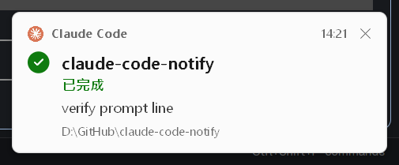

# Claude Code Notify

Claude Code 的 Windows 通知卡片。Claude 回完話或需要你輸入時，工作列上方會跳出一張小卡片，點一下就回到你下指令的那個視窗和 Windows Terminal 分頁。

[English](README.md)




這個專案 fork 自 [chuilishi/claude-code-notify](https://github.com/chuilishi/claude-code-notify)。1.2.0 版重新設計了卡片外觀，修掉參數引號和卡片堆疊的 bug，也精簡了 Rust 程式。

## 功能

- **完成通知**：Claude 回完話會跳卡片，卡片上寫著你剛送出的 prompt，看一眼就知道是哪件事做完了。
- **點一下跳回去**：點卡片會把你下指令的視窗拉回前面，縮小了也會還原。用 Windows Terminal 的話，還會切回原本的分頁。按完 Enter 馬上切去 Slack 或瀏覽器也沒關係，點卡片回到的是跑 Claude Code 的那個 app，不是當時在最前面的視窗。
- **閒置提醒**：Claude 在等你回覆而你一直沒回時，Claude Code 會發出閒置通知（預設大約 60 秒），卡片寫「等你回覆」。人走開了，回來也不會漏掉。
- **授權請求**：Claude 要執行工具、需要你同意時，卡片寫「需要授權」，並列出它要做的事。
- **提問和計畫**：Claude 用 `AskUserQuestion` 問你問題時，卡片直接顯示題目。plan mode 擬好計畫（`ExitPlanMode`）時，卡片寫「計畫待確認」。
- **MCP 詢問**：MCP server 要你輸入資料時，也會跳卡片。登入成功、MCP 詢問已完成或已回覆這類不用你處理的通知，直接略過。
- **多個 session 同時開**：每個 Claude Code session 各存各的狀態，點每張卡片都會回到各自的視窗和分頁。
- **不會被系統 prompt 蓋掉**：Claude Code 自己塞進來的 prompt（背景工作通知、subagent 回報）不會蓋掉你最後打的 prompt，也不會改掉記下的視窗。
- **人不在就等你**：倒數期間沒碰鍵盤滑鼠，卡片會一直留著，等你回來才重新倒數、關掉。
- **卡片堆疊**：好幾張卡片從工作列往上疊，不會互相蓋住，一張一張收掉。

## 安裝

```bash
claude plugin marketplace add kglobe/claude-code-notify
claude plugin install claude-code-notify@claude-code-notify
```

裝完重開 Claude Code。plugin 會自己註冊 hooks，不用改 `settings.json`。

移除：

```bash
claude plugin uninstall claude-code-notify
```

### WSL 出現 `Permission denied`

在 WSL 裡裝 plugin，hook 執行時若出現 `Permission denied`，把附帶的 exe 設成可執行：

```bash
chmod +x ~/.claude/plugins/cache/claude-code-notify/claude-code-notify/*/notifications/ToastWindow.exe
```

這是上游 [issue #2](https://github.com/chuilishi/claude-code-notify/issues/2) 的做法。shell 沒展開 `*` 的話，換成版本目錄，例如 `1.2.0`。

## 卡片內容

由上到下：

| 列 | 內容 |
|----|------|
| 標頭 | Claude 圖示、「Claude Code · 資料夾名稱」、時間、關閉鈕 |
| 狀態 | 左邊的圖示完成時是勾，需要你處理時是警告符號。右邊的標籤是已完成、需要授權、等你回覆、MCP 詢問、有問題要問你、計畫待確認、需要你輸入，七種之一 |
| 訊息 | 你最後一次的 prompt，或 Claude 的問題、要授權的內容，用卡片上最大的字 |
| 頁尾 | 完整工作目錄和「點擊切回視窗」，最底下的細條顯示剩下的顯示時間 |

卡片跟著系統的亮色或暗色主題，也會依 DPI 縮放。需要你處理的卡片底色偏黃、邊框是警示色。狀態文字固定是繁體中文，沒有設定可以改。

## 操作

| 動作 | 結果 |
|------|------|
| 左鍵點卡片 | 把原本的視窗拉到前面，切回原本的 Windows Terminal 分頁 |
| 右鍵或點 X | 關掉卡片 |
| 滑鼠移到卡片上 | 所有卡片暫停倒數 |

每張卡片顯示 6 秒，再花 0.6 秒淡出。好幾張疊在一起時，只有最靠近工作列的那張在倒數，其他的排隊等。

這 6 秒內完全沒有鍵盤或滑鼠輸入的話，就當作你不在，卡片會留著，進度條回到全滿。之後一有輸入（每 0.5 秒檢查一次），就重新倒數 6 秒，這次倒數完一定會關掉。

跳卡片時會播音效，用 `notifications/assets/sound/` 裡第一個 `.wav`，找不到就播 Windows 的「星號」系統音效。

## 運作方式

plugin 只有一支 exe，`notifications/ToastWindow.exe`，由 `hooks/hooks.json` 的五個 hook 呼叫：

| Hook | 參數 | 做什麼 |
|------|------|--------|
| `UserPromptSubmit` | `--save` | 記下跑 Claude Code 的那個 app 的視窗（認不出來就記前景視窗）、Windows Terminal 目前的分頁、呼叫端 app 的 exe 路徑和你的 prompt。開頭是 `<task-notification>` 或 `<agent-message ` 的 prompt 是 Claude Code 自己塞的，直接略過 |
| `Notification` | `--input` | 顯示「需要輸入」卡片（授權、閒置、MCP elicitation） |
| `PreToolUse`，matcher `AskUserQuestion\|ExitPlanMode` | `--input` | 顯示「有問題」或「計畫待確認」卡片 |
| `Stop` | `--notify` | 顯示「已完成」卡片 |
| `SessionEnd` | `--cleanup` | 刪掉這個 session 的狀態檔 |

狀態存在 `%TEMP%\claude-notify-{session_id}.txt`，一個 session 一個檔，所以同時開好幾個 Claude Code 視窗也不會互相蓋掉。

hook 呼叫的那支 exe 會馬上結束，另外用 `--notify-show` 起一支獨立的 exe 畫卡片，這支要等卡片關掉才結束。

視窗和分頁怎麼對回去：

- 視窗：從 hook 的 process 往上找，跳過 shell 和 runtime，第一個遇到的 app 就是目標。要跳過的 process 清單和認得的 app 清單（VS Code、Cursor、Windsurf、JetBrains IDE、Windows Terminal 等）都在 `src-rust/src/process.rs`。
- Windows Terminal 分頁：送出 prompt 時用 UI Automation 記下分頁的 RuntimeId，點卡片時再選回那個分頁。
- 背景 process 要把視窗拉到前面，Windows 會擋，所以要連續呼叫好幾個 Win32 API，寫在 `src-rust/src/activate.rs`。

卡片不會搶焦點（`WS_EX_NOACTIVATE`），永遠在最上層。卡片之間靠視窗類別 `ClaudeCodeToast` 找到彼此，疊起來不會重疊。

## 自己建置

要在 Windows 裝好 Rust。

```bash
cd src-rust
cargo test
cargo build --release
cp target/release/toast-window.exe ../notifications/ToastWindow.exe
```

hook 指令加上 `--debug`，log 會寫到 exe 旁邊的 `debug.log`。

不開 Claude Code 也能看 release 版的卡片：用 PowerShell 7 跑驗證腳本（腳本用到 `ArgumentList`，Windows PowerShell 5 沒有）。`-Mode` 可以是 `notify`、`input`、`stack`、`doctor`，截圖存到 `verify-evidence/`。

```powershell
pwsh .claude/skills/verify-toast/verify.ps1 -Mode stack
```

有些防毒軟體會擋剛建好的 exe，要先放行。

## 授權

MIT
